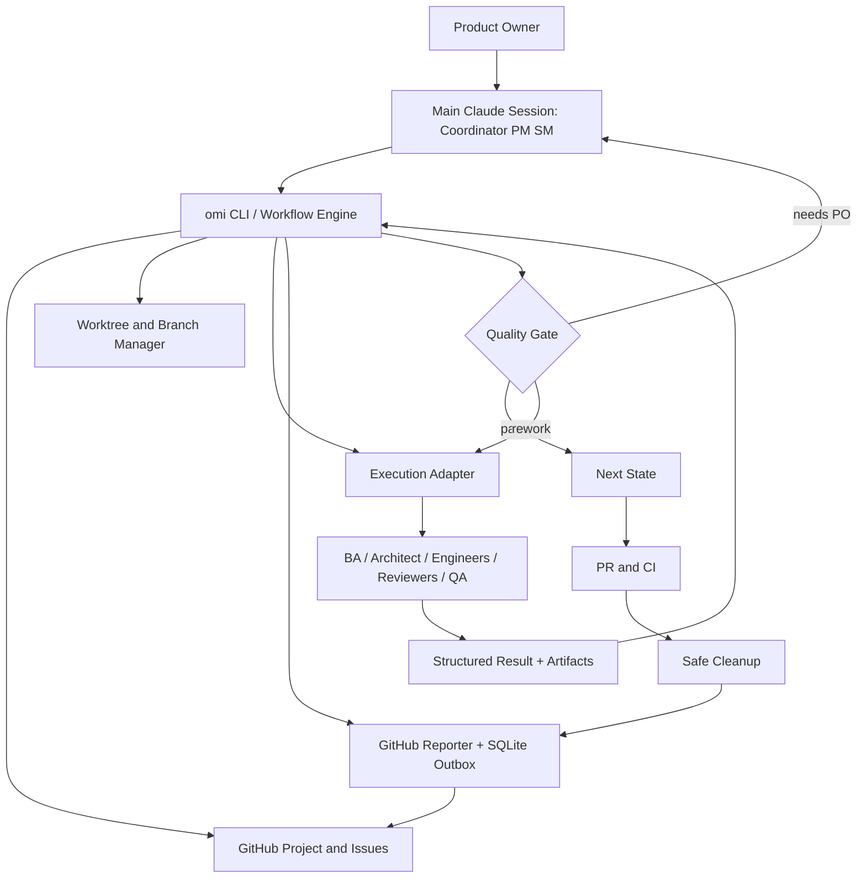

# OMI Engineering Plugin — Product Idea & Architecture Specification

> Version: 2.1 · Updated: 2026-11-17 · Status: **Architecture baseline; Phase 0 complete — synchronized with [ADR-0001](./docs/decisions/ADR-0001-phase0-outcomes.md)**  
> Repository: `omi-plugins` · Plugin ID: `omi-engineering` · Language: Vietnamese (technical identifiers in English)  
> Companion: [`omi-plugins-roadmap.md`](./omi-plugins-roadmap.md)

## 0. Executive decision record

OMI is a **ticket-driven, script-first Agile engineering framework** packaged as a Claude Code plugin plus a deterministic local runtime. It is **not** merely a collection of agent prompts. It coordinates specialist LLM work while keeping routine operations in scripts, ensures traceability to GitHub Issues/Projects, isolates each executable ticket in a Git worktree, enforces review/rework gates, and cleans resources after merge.

### Fixed decisions (MUST)

1. **One main Claude Code session = Coordinator + Project Manager + Scrum Master.** There is no coordinator/PM/SM subagent. Main session handles planning, routing, exception handling and PO communication, not ordinary source implementation or independent review.
2. **Eleven specialist subagents:** business-analyst, solution-architect, ui-ux-designer, frontend-engineer, backend-engineer, database-engineer, code-reviewer, security-reviewer, manual-qa-engineer, automation-qa-engineer, devops-engineer.
3. **Model policy:** main Sonnet / medium by default; specialists default medium effort; Architect, Code Reviewer and Security Reviewer default Opus; others Sonnet. Runtime model actuals must be observed, not inferred from intended configuration. Overrides only within tested host capabilities, cost and policy bounds. *(Phase 0: agent `model:` and workflow `agent({model})` overrides verified via `modelUsage`; effort is **not observable** on Claude Code 2.1.325, so `actualEffort` is recorded as `unknown` — ADR-0001 D2.)*
4. **AGENTS.md** is the canonical project-instructions file. Validate Claude Code version and instruction precedence; never assume every Claude version reads it. No unconditional `CLAUDE.md` generation; use import shim only for compatibility when needed and approved.
5. **Specialist knowledge is resource-only (absolute isolation, ADR-0001 D3).** Specialist knowledge and rule packs live in `resources/role-rules/<role>/` and are **not registered as skills**, so main never sees their names, descriptions or bodies. Each agent body reads its pack by explicit path `${CLAUDE_PLUGIN_ROOT}/resources/role-rules/<role>/...` and sets `disallowedTools: Skill`. The launcher grants read access to that directory (`Read(//<plugin-root>/resources/**)` or `--add-dir`). Plugin skills exist only for Coordinator entry points. This is isolation by default, not a security boundary (main could still `Read` the files deliberately). Repo `.claude/rules` is independent and may load into main — cannot guarantee complete main-context exclusion for those files.
6. **Script first.** Git/GitHub/CI/checks/reporting/state/cleanup must use CLI, libraries or API without LLM-mediated reasoning when deterministic. Batch commands, compact JSON outputs, external log retention.
7. **Every unit of work is a GitHub Issue belonging to the configured GitHub Project** (not a draft project item). An executable task gets one owned branch and one owned worktree, from a freshly fetched `origin/develop`. Both `main` and `develop` are long-lived; release PR is `develop → main` with a Release Issue.
8. **Code-changing PRs have exactly one primary executable Issue** and target `develop` (release is a distinct exception). Prefer Dev Task as PR primary; Bug/Feature/FR/NFR may decompose to task issues. Validate real association, not an unverified string.
9. **Developer ↔ Reviewer loop:** rounds 1–2 then architect escalation if both fail; rounds 3–4 after architect; if round 4 fails stop, mark `WAITING_PO`, preserve worktree and notify PO. Infrastructure/tool failures do not count as review failures.
10. **Every finished workflow step** (including failure/skip/escalation, deterministic steps and cleanup) creates or updates one structured comment on current Issue **before** next step is dispatched. Include step/round/attempt/role/model/effort/result/evidence/next action. CLI owns publishing; agents only return structured results.
11. **After successful merge**, cleanup is a mandatory finalization stage: validate PR and ownership, archive evidence, stop owned processes/containers, remove worktree and local branch safely, prune stale metadata, apply log/cache retention and post cleanup comment. Blocked work stays recoverable. No blind `--force` deletion.
12. **GitHub Free compatibility:** prefer native Projects/Issues/Sub-issues/Dependencies/fields/views; OMI CLI fills automation gaps. Public repos support Free branch protections; private Free repositories require explicit warning and compensating controls, not fictional protection.
13. **Do not implement unsupported native integration on assumption.** Eight blocking technical spikes precede production build (Section 17) — completed 2026-11-17, outcomes in ADR-0001.
14. **Execution adapter (ADR-0001 D1):** the OMI CLI launches each named agent as its own process (`claude -p --agent omi-engineering:<role>`, cwd = the task's OMI worktree, stream-json output for model observation). Native Dynamic Workflows are an **optional** adapter for read-only parallel steps only (`agent({agentType, schema})`); `isolation: 'worktree'` is forbidden everywhere.

## 1. Goals, non-goals and boundaries

### Goals

- Professional multi-level issue tree, sprint planning, agile lifecycle, requirements-to-code traceability.
- Deterministic, reliable task setup, transitions, GitHub comment audits, PR linking, resource cleanup and resume across interrupted sessions.
- Distinct responsibility for every specialist; avoid duplicate analysis and full reimplementation on rework.
- Cost efficiency, compact context and predictable quality gates.
- Reuse one plugin across different repositories while respecting each repository's architecture/technology.
- Local first; works with GitHub Free and Claude Code installed on user's workstation.

### Non-goals for initial release

- Build a Jira replacement, proprietary GitHub Projects UI or independent GitHub Issue database.
- Replace Product Owner approvals or promise 100% deterministic LLM behavior.
- Multi-provider autonomous agent orchestration in MVP; adapter abstraction permits it later.
- Production deployments by default; add behind explicit approval and environment controls.
- Guaranteed exactly-once side effects across GitHub and SQLite (use outbox + idempotency + reconciliation instead).
- Assuming workflow JavaScript can access filesystem, shell or arbitrary libraries.

### Architectural separation

| Layer | Responsibility | Authoritative state |
|---|---|---|
| Main Claude session / Coordinator | understand intent, select workflow, communicate PO | conversation + compact summary |
| Claude Code Plugin | specialist agents, skills, entrypoints, optional native workflow adapters | versioned plugin source |
| OMI deterministic runtime | state machine, policy, ticket API, worktrees, GitHub reporting, cleanup | local SQLite and execution artifacts |
| GitHub Project + Issues | business work hierarchy, status, assignee, PR links, audit comments | GitHub server |
| Target repository | code, tests, AGENTS.md, project-specific rules | Git repository |
| CI / hooks | validate policies and code independent of agent compliance | CI evidence |

## 2. End-to-end interaction model



**Dispatch invariant:** `STEP_RESULT_PERSISTED → REPORT_CONFIRMED → TRANSITION_COMMITTED → NEXT_STEP_DISPATCHED`. Every step is recorded before transitioning. A failed GitHub reporting call leaves a pending outbox receipt and blocks next dispatch until reconciliation.

## 3. Roles and effective model policy

| Role | Group | Default model | Default effort | Main responsibility |
|---|---|---|---|---|
| Coordinator + PM + SM (main) | Control | Sonnet | medium | intake, decomposition, routing, status, escalation, PO |
| business-analyst | Analysis | Sonnet | medium | FR/NFR, story, acceptance criteria |
| solution-architect | Architecture | Opus | medium | architecture, ADR, contracts, diagnosis after 2 fails |
| ui-ux-designer | Design | Sonnet | medium | UX, wireframe/design contracts, accessibility |
| frontend-engineer | Engineering | Sonnet | medium | frontend changes and focused FE tests |
| backend-engineer | Engineering | Sonnet | medium | API, services, domain behavior and BE tests |
| database-engineer | Engineering | Sonnet | medium | schema, migrations, query tuning |
| code-reviewer | Quality | Opus | medium | correctness, maintainability, design compliance |
| security-reviewer | Quality | Opus | medium | threat/risk analysis, security review |
| manual-qa-engineer | Quality | Sonnet | medium | test design, acceptance and exploratory QA |
| automation-qa-engineer | Quality | Sonnet | medium | create/repair automated test suites; not merely run tests |
| devops-engineer | Operations | Sonnet | medium | pipeline/infrastructure design and code when needed |

**Routing:** configurable defaults by role; upgrade only for proven complexity or review uncertainty and under policy; no automatic escalation to high effort. Verified in Phase 0: aliases `sonnet`, `opus`, `haiku` resolve to `claude-sonnet-5-5`, `claude-opus-5-5`, `claude-haiku-5-5`. Record `requestedModel`, `actualModel` (from stream-json `message.model` / result `modelUsage`), `requestedEffort`, `actualEffort` (`unknown` — not observable on 2.1.325). The main session model is configured at session level, not via an invented `coordinator.md`.

## 4. Role/knowledge isolation

### Desired behavior

- Coordinator sees agent names/descriptions needed for routing and only uses orchestration entry skills such as `omi-start`, `omi-task`, `omi-status`, `omi-resume`, `omi-release`. These are the **only** plugin skills.
- Specialist knowledge (implementation guidance, review checklists, test design, etc.) and specialist rules are reference documents in `resources/role-rules/<role>/`. They are **not** skills, are not discovered, and are loaded only by the explicit `${CLAUDE_PLUGIN_ROOT}/resources/...` paths written in the agent body; NOT copied to `.claude/rules` merely to expose them.
- Every specialist agent sets `disallowedTools: Skill`. Resource loading is not an authorization boundary; agents can read other files if allowed by tools.
- The CLI launcher passes read permission for `<plugin-root>/resources/` only (`--allowedTools "Read(//<plugin-root>/resources/**)"` or `--add-dir <plugin-root>/resources`); without it the Read is denied (verified in Phase 0, T0.2).
- Project `.claude/rules/` and `AGENTS.md` may apply to main and subagents according to Claude's documented loading. Main exclusion from project rules is not technically assured by plugin design alone. Keep project root instructions concise and routing-focused; path-specific project rules limit irrelevant loads.
- Repo requirements outrank generic OMI best-practice guidance unless they conflict with higher priority system/organizational policies or explicit security guardrails.

### Example agent definition (fields verified on Claude Code 2.1.325)

```markdown
---
name: backend-engineer
description: Implement approved backend task changes in the assigned OMI task worktree.
model: sonnet
effort: medium
tools: Read, Edit, Write, Bash, Grep, Glob
disallowedTools: Skill
---
Before acting, Read these files and follow them:
${CLAUDE_PLUGIN_ROOT}/resources/role-rules/backend/implementation.md
${CLAUDE_PLUGIN_ROOT}/resources/role-rules/backend/api-contracts.md
${CLAUDE_PLUGIN_ROOT}/resources/role-rules/backend/unit-test-design.md
```

`${CLAUDE_PLUGIN_ROOT}` is substituted with the plugin's absolute path inside agent bodies (verified). Do not use `isolation: worktree` or `skills:` for specialist content.

**Never confuse a plugin agent with a project agent:** some frontmatter features differ by scope. Permission enforcement must live in project/managed settings, hooks, CLI, protected branches and CI where supported.

### Role-resource map (baseline)

| Agent | Resource pack `resources/role-rules/<pack>/` | Knowledge files (one topic per file) |
|---|---|---|
| BA | `analysis/` | requirement-analysis, acceptance-criteria |
| Architect | `architecture/` | system-design, api-contracts, adr-management, root-cause-analysis |
| UI/UX | `design/` | ux-flows, ui-design, accessibility |
| Frontend | `frontend/` | frontend-implementation, component-testing |
| Backend | `backend/` | backend-implementation, api-contracts, unit-test-design |
| Database | `database/` | schema-design, database-migration |
| Code Reviewer | `code-review/` | semantic-code-review, architecture-compliance |
| Security Reviewer | `security-review/` | threat-assessment, security-review |
| Manual QA | `manual-qa/` | test-case-design, exploratory-qa |
| Automation QA | `automation-qa/` | automated-test-authoring, test-maintenance |
| DevOps | `devops/` | ci-cd-engineering, deployment-design, observability |

Shared knowledge (e.g. `api-contracts` for Architect and Backend) lives once under `resources/shared/` and is referenced by path from each agent; never duplicate content verbatim. Files must be narrow; agents read only the files listed in their body. Pin instructions to specific artifacts rather than flooding each agent with project history.

## 5. Target plugin repository layout

```text
omi-plugins/
├── AGENTS.md                           # Contributor/development instructions for OMI itself
├── README.md
├── package.json                        # TypeScript/Node runtime
├── tsconfig.json
├── .gitignore
├── .claude-plugin/
│   ├── plugin.json
│   └── marketplace.json                # single-plugin marketplace (validate local source)
├── agents/
│   ├── business-analyst.md
│   ├── solution-architect.md
│   ├── ui-ux-designer.md
│   ├── frontend-engineer.md
│   ├── backend-engineer.md
│   ├── database-engineer.md
│   ├── code-reviewer.md
│   ├── security-reviewer.md
│   ├── manual-qa-engineer.md
│   ├── automation-qa-engineer.md
│   └── devops-engineer.md
├── skills/                             # Coordinator entry points ONLY (ADR-0001 D3)
│   ├── omi-start/SKILL.md
│   ├── omi-task/SKILL.md
│   ├── omi-resume/SKILL.md
│   ├── omi-status/SKILL.md
│   └── omi-release/SKILL.md
├── workflows/                          # OPTIONAL read-only adapters (ADR-0001 D1); no isolation: worktree
│   └── review-gate.js                  # e.g. parallel multi-lens review; CLI publishes results
├── hooks/
│   └── hooks.json
├── resources/                          # not discovered by Claude Code; read by explicit path only
│   ├── shared/                         # knowledge reused by several roles (e.g. api-contracts.md)
│   └── role-rules/
│       ├── analysis/                   # requirement-analysis.md, acceptance-criteria.md, rules
│       ├── architecture/               # system-design.md, adr-management.md, root-cause-analysis.md
│       ├── design/                     # ux-flows.md, ui-design.md, accessibility.md
│       ├── frontend/                   # frontend-implementation.md, component-testing.md
│       ├── backend/                    # backend-implementation.md, unit-test-design.md
│       ├── database/                   # schema-design.md, database-migration.md
│       ├── code-review/                # semantic-code-review.md, architecture-compliance.md
│       ├── security-review/            # threat-assessment.md, security-review.md
│       ├── manual-qa/                  # test-case-design.md, exploratory-qa.md
│       ├── automation-qa/              # automated-test-authoring.md, test-maintenance.md
│       └── devops/                     # ci-cd-engineering.md, deployment-design.md, observability.md
├── runtime/
│   ├── cli/                            # parse, execute, compact output
│   ├── core/
│   │   ├── workflow-engine/            # transitions, deterministic gates
│   │   ├── policy-engine/
│   │   ├── agent-routing/
│   │   ├── handoff/
│   │   └── errors/
│   ├── adapters/
│   │   ├── claude/                     # tested named-agent invocation adapter
│   │   ├── github/                     # REST/GraphQL, rate limits
│   │   ├── git/
│   │   └── process/
│   ├── reporting/                      # renderer, outbox, reconciliation
│   ├── resources/                      # worktree, cache, cleanup ownership
│   └── persistence/                    # SQLite migrations and repositories
├── config/
│   ├── model-routing.yaml
│   ├── workflow-policy.yaml
│   ├── branching-policy.yaml
│   ├── resource-policy.yaml
│   ├── risk-policy.yaml                # Low/Medium/High merge tiers (§6 Governance)
│   └── github/                         # governance defaults; target repo overrides in .omi/config.yaml
│       ├── project.yaml
│       ├── issue-types.yaml
│       ├── issue-hierarchy.yaml        # allowed parent → child matrix
│       ├── labels.yaml                 # type:*, risk:*, flag:*
│       ├── fields.yaml
│       ├── status-transitions.yaml
│       ├── views.yaml
│       └── repository.yaml             # branch protection, merge methods
├── schemas/
│   ├── workflow-state.schema.json
│   ├── step-result.schema.json
│   ├── handoff.schema.json
│   ├── review-findings.schema.json
│   ├── github-comment.schema.json
│   └── cleanup-result.schema.json
├── templates/
│   ├── project/AGENTS.md
│   ├── github/issues/                  # one Issue Form per OMI type + config.yml, rendered into target repo
│   ├── github/pull-request.md          # rendered to target repo .github/PULL_REQUEST_TEMPLATE.md
│   └── reports/
│       ├── analysis.md
│       ├── architecture.md
│       ├── implementation.md
│       ├── code-review.md
│       ├── security-review.md
│       ├── manual-qa.md
│       ├── automation-qa.md
│       ├── architect-escalation.md
│       ├── po-escalation.md
│       ├── pr.md
│       └── cleanup.md
├── bin/omi                            # CLI launcher; executable
├── docs/
│   ├── decisions/                      # ADRs
│   ├── architecture/
│   ├── contracts/
│   └── runbooks/
├── tests/
│   ├── unit/
│   ├── integration/
│   ├── contract/
│   ├── e2e/
│   └── fixtures/
├── evals/                              # agent/skill routing probes
└── .github/workflows/
    ├── validate.yml
    └── release.yml
```

### Directory ownership

- `.claude-plugin/`, `agents/`, `skills/`, `workflows/`, `hooks/` follow Claude Code plugin contracts (Phase 0 verified: agents register as `<plugin>:<name>`, skills as `<plugin>:<name>`, plugin workflows load from `workflows/` and run as `/<plugin>:<meta.name>`).
- `resources/`, `config/`, `schemas/`, `templates/`, `runtime/`, `tests/` are OMI-owned, not magic Claude directories.
- `workflows/*.js` **must not** duplicate state-machine logic or perform writes. Verified script API: `agent(prompt, {label, phase, schema, model, effort, isolation, agentType})`, `parallel`, `pipeline`, `phase`, `log`, `args`; no `cwd` option; no filesystem/shell/`import()`; `Date.now()`/`Math.random()` throw. Workflows are available only when the user enabled them (`"enableWorkflows": true`); `omi doctor` disables the adapter otherwise. Direct orchestration through CLI/Coordinator is the primary path.
- `bin/omi` must resolve plugin paths and environment reliably, including Windows. Never embed developer-specific absolute paths.
- No generated files are placed in arbitrary repository locations; update this directory contract through ADR before introducing new root folders.

## 6. GitHub Projects Free design

### Project and Issue system of record

- One Project per product/program, optionally spanning multiple repositories.
- All executable work is backed by a real Issue in a configured repo and Project; draft project items must be converted before task execution.
- Parent-child relation uses native **sub-issues**; dependency uses native **blocked by / blocking**; these are distinct.
- Actual GitHub limits: **up to 8 nested levels, 100 direct sub-issues per parent**. OMI operating recommendation: <=6 levels and ~15–20 children unless justified. Verify feature availability and permissions on actual account.
- Issue closure and project Status are separate; do not infer acceptance from a closed issue or merged PR alone.
- Project configuration as desired-state files with `plan → human-approved apply → verify`; non-destructive by default.

### Issue Types

`Milestone`, `Epic`, `Feature`, `FR`, `NFR`, `Change Request`, `Bug`, `Dev Task`, `Test Task`, `DevOps Task`, `Documentation Task`, `Spike`, `Release`.

**Mapping (ADR-0001 D6):** native org Issue Types are org-owner controlled; `omi-home` currently has `Task`, `Bug`, `Feature`. OMI uses the native type where one matches (`Bug`→Bug, `Feature`→Feature, executable tasks→Task) and the label `type:<OMI type>` as the authoritative OMI type for all 13 types. Creating new org Issue Types requires separate org-owner approval.

An Issue of any type may have sub-issues if appropriate. Do not force empty hierarchy levels. Branch/PR normally attach to terminal executable issues; application-code PRs require Dev Task as primary Issue. Release PR uses Release Issue, with `develop → main` exception.

### Example hierarchy

```text
Milestone #10  Identity MVP
└── Epic #11  Authentication
    ├── Feature #12  Customer Registration
    │   ├── FR #13  Register by Email
    │   │   ├── Dev Task #16  API
    │   │   └── Dev Task #17  UI
    │   └── NFR #14  Credential Security
    │       └── Dev Task #18  Password Policy
    └── Bug #19  Failed Signup Validation
        └── Dev Task #20  Fix Validator
```

### Project fields

Start small: Status, Priority (P0..P3), Iteration, Story Points, Domain, Workstream, Target Date, Release, Acceptance, Risk. Prefer native Issue Type, Assignee, Parent, Linked PR, State and Label over duplicate text fields. Distinguish organization Issue Fields from per-Project fields; only create features actually accessible to this account. Verify API field mutations and permissions during spike.

Status: `Backlog → Ready → In Progress → In Review → In QA → Done`, with `Blocked`, `Rework`, `Cancelled`, `Waiting PO` as alternative or policy states. Internal workflow state is more granular and maps to these Project statuses.

Views: WBS Table, Backlog Table, Sprint Board, Review & QA, Blockers/Risks, Release Roadmap, Delivery Insights. Phase 0 verified: `createProjectV2View` creates TABLE/BOARD/ROADMAP views by name + layout, but filters/grouping/sorting are **not** settable via API (`configuration` only has `visibleFieldIds`) → OMI creates views and generates manual setup steps for filters/grouping.

**API idempotency (verified):** `addSubIssue`, `addBlockedBy` and `createProjectV2Field` fail on duplicates; `createProjectV2View` silently creates duplicates; `addProjectV2ItemById` is idempotent. Therefore every GitHub mutation follows **read → diff → write** against desired state.

### Governance as a product capability

Everything in this section is a feature OMI applies to **any target repository and Project**, not a one-off setup of the OMI repository itself (PO, 2026-11-17, F6.3). Defaults ship in `config/github/` and `config/risk-policy.yaml`; a target repository overrides them in its `.omi/config.yaml`. GitHub never reads these files: they are inputs for `omi github project …` and `omi github repo …`, which follow **discover → plan (dry-run diff) → PO-approved apply → validate (read back)**, reapply with zero writes, and report drift instead of overwriting it.

| Area | Desired state | Enforced by |
|---|---|---|
| Issue type | native type where it matches + `type:<OMI type>` label (D6) | script (validator) |
| Hierarchy | allowed parent → child matrix per OMI type; cycles and depth/width limits rejected | script; GitHub only stores the links |
| Issue Forms | one form per OMI type (required sections: e.g. Bug repro/expected/actual/severity, NFR threshold + verification, Change Request current/proposed/impact/decision, Spike question/timebox/output) + `config.yml` disabling blank issues; PR template with `Closes #<issue>` and evidence checklist | GitHub renders forms; script re-validates content and metadata after creation (forms cannot set Project fields) |
| Labels | `type:*`, `risk:low\|medium\|high`, `flag:needs-po\|blocked\|security`; idempotent create/update; duplicate-meaning or foreign labels reported, never deleted | script |
| Fields, Status, views | §6 Project fields; one source of truth per attribute; field/option IDs read from GitHub, never hard-coded | script; views partly manual (API limits) |
| Status transitions | allowed `ProjectStatus` transition matrix; Status ≠ Open/Closed, synchronised conditionally, parents never auto-closed | script checks its own moves and reports external drift |
| Branch protection | `main` + `develop`: PR required, no force push/deletion, `enforce_admins`, conversation resolution; linear history per branch (release `develop → main` may need a merge commit); never loosened without PO | GitHub (public repos on Free, D5) |
| Merge settings | allowed merge methods (task PR = squash), branch auto-delete per `cleanup` policy | GitHub settings + script |
| Risk tiers | Low (docs, small tests, simple refactor), Medium (normal Feature/Bug) → OMI may merge after gates; **High** (auth, security, destructive migration, breaking API, governance config) → `WAITING_PO`, PO verifies and merges | script only |

Governance changes are themselves **High risk**: an apply needs an explicit PO-approved plan, and OMI never asks for or stores a PO token (separate PO and agent credentials; doctor warns when the agent token has admin rights).

**Trust limit:** local checks and commit statuses published by the agent are not an independent control against that agent, and GitHub has no native per-PR risk-based approval. Only server-side branch protection is a real barrier; High-risk PRs therefore stop for a human merge by default, and OMI reports this limit instead of claiming enforcement.

### Issue body as living documentation

The Issue body is the **project documentation and the agent context** for what it describes (PO, 2026-11-17). Requirements, scope, acceptance, design decisions and the as-built result of a Feature/FR/NFR/Change Request live in its body, not in parallel files under `docs/`.

- **Structure:** each Issue Form defines the documentation sections for its OMI type (e.g. Objective, Context, Scope, Acceptance, Design/Decisions, As-built). Sections are bounded by markers (`<!-- omi:section=<name> -->`) so the CLI can read and update one section without rewriting the rest.
- **Living, not a log:** the body holds the current truth; history stays in comments (step reports, evidence) and in GitHub's edit history. When a task changes what its parent describes (decision taken, behaviour as built), the CLI updates the parent's section and posts a comment linking the change. Agents propose the text in their step result; they never edit Issues directly (script first).
- **Agent context:** the task packet (§11) carries the executable Issue's body plus its ancestor chain (parent Feature/FR/Epic…) with a size budget; agents read Issues, not chat or copied files.
- **`docs/` = overview + references only:** architecture overview, ADRs, contracts and runbooks that must be versioned with the code; feature-level detail links to the Issue instead of duplicating it.
- **Limits:** body edits are not reviewed through a PR, so changes to an accepted section by anyone but the PO/CLI are reported as drift; a body has a size cap (verify on the actual API before relying on it) — split into child Issues rather than growing one body.

### Native GitHub Free caveat

GitHub Free branch protection works for **public** repositories (Phase 0: classic protection and rulesets both blocked a direct push to `develop` by a repo admin with `enforce_admins`). On **private** Free repositories both APIs return 403 "Upgrade to GitHub Pro or make this repository public", and a direct push succeeded. OMI local checks and CI reporting may detect violations but cannot prevent bypass there. **ADR-0001 D5:** prefer public repositories; a private Free repository requires a recorded PO risk acceptance and an `omi doctor` warning, or a plan upgrade if strict enforcement is mandatory.

## 7. Git branching and worktree isolation

```text
main       ← release PR from develop  (stable, production)
develop    ← task PRs from task branches (default integration branch recommended)
feature/<issue>-<slug>
bugfix/<issue>-<slug>
refactor/<issue>-<slug>
chore/<issue>-<slug>
docs/<issue>-<slug>
test/<issue>-<slug>
```

- Require `git fetch origin develop` and create branch from `origin/develop`; record base SHA.
- Per executable Issue: **one owned task branch and one owned worktree**, mapped by `repo-id + issue-id` and tracked in SQLite. Calling `task start` twice reuses existing healthy workspace.
- Worktree path outside main checkout, e.g. `../.omi-worktrees/<repo>/<issue-id>/`; validate canonical path, ownership marker, collisions and symlinks before operating.
- One task may pass through several specialists serially in its same worktree; concurrency across tasks only if ownership and dependencies allow. Do not spawn automatic nested/hidden worktrees without management state.
- Never develop on `main` or `develop`; no direct pushes to either under OMI policy.
- PR for code task → `develop`, linked to one primary Issue. **ADR-0001 D4: `develop` is the default branch.** Phase 0 verified: with `develop` as default, `Closes #N` populates `closingIssuesReferences` (asynchronously, within ~15 s) and squash merge closes the Issue; with `main` as default, a PR into `develop` gets no closing reference and the Issue stays open. The PR validator polls `closingIssuesReferences` with backoff until exactly one primary Issue appears.
- Release requires Release Issue; PR `develop → main`. Explicit exceptions for production hotfix require PO-approved ADR rather than silently breaking base-branch rule.
- Branch existence does not imply task merge; validate PR's GitHub merged state, base, head, owner and commit prior to cleanup, including squash/rebase merges. Phase 0: after a squash merge `git branch --merged` omits the merged branch and wrongly lists untouched branches (zero commits beyond base) — never use it as merge evidence. Merge evidence = PR `merged`, base `develop`, head branch, `headRefOid` == local tip == remote tip, primary Issue.

### High-level CLI contract (planned, not already implemented)

```bash
omi doctor
omi github project plan
omi github project apply --approved-plan <path>
omi github project validate
omi github repo plan
omi github repo apply --approved-plan <path>
omi github repo validate
omi issue tree <issue-number>
omi ticket validate <issue-number>
omi task start <issue-number> --output json
omi task status <issue-number> --output json
omi task resume <issue-number>
omi quality check <issue-number>
omi pr create <issue-number>
omi pr validate <issue-number>
omi task finalize <issue-number>
omi cleanup scan
omi cleanup apply --safe
omi doctor --resources
```

All commands must support structured stdout, non-zero exit codes, compact errors, dry-run where applicable, idempotency and ownership checks. Long output/logs stored outside LLM context with bounded size and retention.

## 8. Ticket-first guardrails and PR traceability

**Mandatory gates:**

1. Ticket exists, active, belongs to project and repo, has valid type, meaningful scope and acceptance criteria.
2. Parent/dependency checks; no unresolved blocking issues unless explicitly authorized.
3. Worktree and branch exist with correct issue ownership and recorded base SHA.
4. Main/agents write only through assigned worktree for executable tasks.
5. PR has correct target (`develop` for task, `main` for release), branch, exactly one designated primary executable Issue, proper association and evidence.
6. CI and review criteria passed before merge; reviewer must be distinct from implementer in OMI role context.
7. Project status updated consistently after merge/acceptance/cleanup; parent not closed if children remain.

Local hooks and OMI checks help but are not security boundaries; server enforcement depends on GitHub plan and repository permissions.

## 9. Script-first execution and token budget

### Deterministic (CLI, no specialist LLM call)

GitHub API reads/mutations, issue/project validation, git fetch/branch/worktree, template rendering, comment publishing, JSON Schema validation, formatting, lint/build/test execution, SAST/dependency scanners, CI/PR checks, resource inventory/cleanup, state transitions, status reporting.

### Cognitive (specialist LLM on demand)

Ambiguous requirements, tradeoffs, architecture decisions, implementation, meaningful code review, risk/threat analysis, exploratory test design, writing missing tests, root cause beyond deterministic diagnosis.

**Call reduction rules:** reuse approved artifacts; only send relevant paths/requirements/diffs; do not pass entire issue comment history; cap handoff summaries; no agent merely to run an existing test or post an Issue comment; avoid rerunning full semantic reviews if only narrow diff changed (review impact carefully); limit concurrent agents to 3 initially; only call architect after two counted review failures or an explicit architecture gate.

### Cost measurement

Record per-step: estimated or instrumented tokens if available, wall time, model, effort, retries, consumed API calls, script/agent execution count, cached artifact reuse. If token metrics unavailable, report `not_available`, never manufacture usage. Use objective before/after baseline to validate savings.

## 10. Workflow engine — explicit finite-state machine

### State layers

- Workflow: `CREATED`, `TICKET_VALIDATED`, `WORKSPACE_READY`, `RUNNING`, `REWORK`, `ARCHITECT_ESCALATION`, `WAITING_PO`, `BLOCKED`, `IN_QA`, `PR_PENDING`, `PR_MERGED`, `CLEANUP_PENDING`, `CLEANUP_FAILED`, `COMPLETED`, `FAILED`, `CANCELLED`, `RECOVERY_REQUIRED`.
- Step: `PENDING`, `RUNNING`, `RESULT_PERSISTED`, `REPORT_PENDING`, `REPORT_POSTED`, `PASSED`, `FAILED`, `BLOCKED`, `SKIPPED`.
- Technical `attempt`: retries for transient tool/transport failure. Domain `round`: new Dev/Review cycle. **Do not increment round for network/API/tool errors.**
- Bounded defaults (PO, 2026-11-17; configurable later): `maxAttempts = 3` technical attempts per step, then `BLOCKED` (non-transient errors block at once); `maxValidationFixes = 2` deterministic-check fixes per round, then `BLOCKED`; `maxQaReworks = 2` QA reworks, then `WAITING_PO`.

### Policy — 2 + Architect + 2

```text
Dev R1 → Validator → Code Reviewer R1
   PASS → QA
   FAIL → Dev R2 → Validator → Code Reviewer R2
                PASS → QA
                FAIL → Solution Architect diagnosis/correction plan
                        ├── needs scope change → WAITING_PO immediately
                        └── accepted correction plan → Dev R3 → Review R3
                              PASS → QA
                              FAIL → Dev R4 → Review R4
                                    PASS → QA
                                    FAIL → WAITING_PO + PO report + preserve worktree
```

- Architect is called **once** by default at two consecutive counted failed review rounds. A severe security issue may trigger earlier Architect/PO escalation via an explicit risk policy; never conceal an exception.
- Reviewer reports structured, actionable findings with IDs/severity/path/expected behavior; rework consumes **delta findings**, not full original prompt.
- Before each cognitive review, deterministic build/lint/test checks run; failures route back to Engineer with separate bounded validation-fix attempts (`maxValidationFixes`). They do not count as reviewer failures.
- Review checks are independently run, reviewing new diff, old findings, touched dependencies and regression risk; failed findings retain stable IDs where possible.
- After rounds exhausted, no fifth Dev attempt; `WAITING_PO` and durable escalation report. Resume only after PO decision and new authorized policy/work item, with audit.
- QA defects after review create a separate bounded rework policy; never silently reset review failure history.

### Workflow catalogue (composable, not giant scripts)

| Workflow | Roles on demand | Gates / exception |
|---|---|---|
| Ticket Intake | Coordinator; BA only if ambiguous | ticket valid, criteria present |
| Requirement Analysis | BA; Architect on needed NFR | specification acceptance |
| Technical Design | Architect; UX if UI | design decision; PO if scope/breaking |
| Feature Implementation | FE/BE/DB selected | deterministic checks, 2+2 review |
| Bug Resolution | Engineer + Reviewer; Architect on escalation | reproduction + regression |
| Change Request | BA → Architect → Engineers | change approval |
| Refactor | Engineer → Reviewer | behavior-preserving tests |
| Quality Assurance | Manual QA, Automation QA only for authoring | acceptance/test evidence |
| PR & Merge | CLI + human / GitHub checks | linked issue, CI, approvals |
| Release | DevOps as needed, CLI, PO | develop→main PR, release ticket |
| Recovery & Cleanup | CLI; no LLM unless novel ambiguity | safe ownership verification |

Task-specific workflow is assembled from reusable stages; do not invoke all 11 agents for every issue.

## 11. Agent handoff contract and anti-duplication

Every agent receives a **task packet** (not full chat):

```json
{
  "workflowRunId": "run-uuid",
  "issue": {"repository": "org/repo", "number": 102},
  "stepId": "implement-backend",
  "round": 2,
  "scope": ["services/identity/"],
  "worktree": "/absolute/validated/task/worktree",
  "baseSha": "abcdef123456",
  "issueContext": ["org/repo#102 (Dev Task)", "org/repo#13 (FR)", "org/repo#12 (Feature)"],
  "openFindingIds": ["CR-001"],
  "carriedFindings": [{"source": "org/repo#98", "id": "CR-002", "action": "classify gh network errors as transient"}],
  "readOnlyArtifacts": ["docs/architecture/auth-adr.md"],
  "outputSchema": "step-result.schema.json"
}
```

`issueContext` is the Issue body chain from the executable Issue up its parents (§6 "Issue body as living documentation"), fetched and size-bounded by the CLI; requirement documents are Issues, not repository files.

Output requires: issue/step/run/round/attempt/role, status, summary, actual changed files, commit SHA, evidence paths, finding IDs, blocker reason, next-step recommendation. **The agent's recommendation does not perform state transition.** Runtime validates schema/ownership and decides action. Specialist cannot redefine scope, call arbitrary other agents or alter ticket status through its prompt.

- BA owns requirements; Architect owns architecture; engineers own implementation; Reviewer owns review findings; QA owns acceptance evidence; Reporter owns GitHub comments.
- Only reopen a previously approved artifact when a concrete failing finding/dependency warrants it. New requirement change gets explicit revision/PO authorization.
- In parallel, assign non-overlapping file scopes and synchronize API contracts; otherwise serialize. Worktrees are per Issue, not per agent.

## 12. Step report and GitHub comment contract

**One terminal report per logical step/round** — not every tool call; include deterministic steps. Agent outputs structured data; Reporter renders from role-specific templates and posts with GitHub API. Persist before publish; publish before next step.

```markdown
<!-- omi:run=RUN_ID;step=STEP_ID;round=2;attempt=1 -->
## OMI Step Report — Code Review

| Field | Value |
|---|---|
| Ticket | org/repo#102 |
| Workflow / Step | Feature Delivery / Code Review |
| Round / Attempt | 2 / 1 |
| Executor | code-reviewer |
| Model / Effort | opus / medium (observed or unknown) |
| Commit | abcdef12 |
| Status | FAILED |

### Summary
Concise conclusion, no redundant full log.

### Evidence & Findings
- CR-001 · High · path:line · observed · expected

### Handoff / Next action
Architect escalation after 2 failed reviews.

_Execution ID: unique-id · Created at: ISO-8601_
```

**Carried findings.** A finding or known limitation that a review or gate defers to another task is posted on that target Issue at once — never only in the source report — as one comment per source step:

```markdown
<!-- omi:carried-findings=T-ID -->
## Findings carried into this task

| Source | Finding | Action |
|---|---|---|
| org/repo#98 · CR-002 | observed problem | what this task must do |
```

The target is resolved from the roadmap/Issue tree, not guessed; a wrong target is corrected on both Issues. When the target task starts, its `carried-findings` comments become part of its scope (`carriedFindings` in the task packet, §11) and its review report states how each was resolved.

For CLI steps: `executor=omi-cli`, `model=null`, `effort=null`. Recording intended values as observed ones is forbidden. Templates in `templates/reports/` cover every required role/step; no LLM reformatting.

### Idempotency and durable outbox

- Marker key: `repo+issue+workflowRun+step+round+attempt` (stable; no collision across resumes).
- SQLite transaction persists step result and pending outbox record.
- Reporter checks for existing comment marker; creates or updates; stores GitHub comment ID and URL.
- On connection ambiguity, search for marker and reconcile; never blindly create duplicate comment. (Phase 0 verified on a real Issue: POST then crash before persisting the comment ID → replay finds the marker and PATCHes; exactly one comment remains.)
- API rate-limit handling: exponential backoff/jitter and limit headers; no busy loop.
- If reporting fails, next step **must not** dispatch until `REPORT_POSTED` or a explicitly PO-authorized exceptional recovery action.
- Only sanitized summaries posted; redact credentials, tokens, PII and local sensitive paths.

## 13. Storage, resume and integrity

- SQLite local: run, step, attempt, review round, transition, worktree ownership, artifact reference, comments outbox, cleanup receipts, execution locks.
- GitHub Issues/Project: authoritative ticket metadata and visible lifecycle; comments: durable audit trail.
- Local artifacts: full logs, diffs/tests/reports under OMI-owned storage directory with bounded retention. No automatic commit of local database or private logs.
- Recovery reconciles GitHub PR/Issue state, Git worktree list, local DB locks and outbox receipts. Replay must never duplicate branch, comments, PR or step dispatch.
- Use lease/lock with expiry + recovery; do not have two main sessions drive same Issue simultaneously.
- SQLite and GitHub not a single transaction; use outbox/saga with idempotent operations and compensating actions where safe.
- Native Claude workflow resume may rerun downstream agents when prompts/results change. **OMI's durable state is authoritative for workflow completion and side effects**, not a blind reliance on native replay.

## 14. Mandatory cleanup and resource lifecycle

### Completion flow

`PR merged verified → archive evidence → stop owned task processes/containers → clean owned temporary artifacts → verify clean worktree → git worktree remove → safe local branch removal → git worktree prune → verify freed resources → GitHub cleanup report → mark completed / close Issue per policy`.

- Squash and rebase merges require verifying GitHub merge state and task linkage, not merely `git branch --merged`.
- No forced deletion on dirty/untracked files, active process, unknown path, foreign worktree, locked worktree or missing evidence. Mark `CLEANUP_FAILED` and keep resource for reconciliation. The worktree ownership marker must be excluded from Git (`.git/info/exclude`) or archived first, otherwise `git worktree remove` refuses without `--force`. Each cleanup step is check-then-act on observable state so replay after a crash is a no-op for completed steps (verified).
- Remote branch deletion is governed by GitHub settings and authorization; never assume it is safe merely because PR is merged.
- Do not clean shared caches, Docker volumes, unrelated logs or repositories. Ownership manifests identify task-specific PIDs/container IDs/cache dirs; verify before touching.
- `WAITING_PO`, `BLOCKED`, `FAILED` preserve essential branch/worktree/step evidence. Stoppable ephemeral services may be safely stopped; archive key logs.
- Retention config: task temp immediately after safe completion; full run logs after configurable days/size caps; completed SQLite records kept for audit unless retention/policy permits archiving.
- Startup/periodic `omi cleanup scan` inventories orphaned OMI-managed worktrees and completed merged tasks; `apply --safe` only removes positively verified resources.
- Cleanup report itself is an auditable step with executor `omi-cli` and no LLM call.

## 15. Permissions, security and guardrails

- Work with least-privilege GitHub tokens: repository issues/PRs/contents (as needed), Projects read/write scopes as tested; never echo/store plaintext auth credentials.
- GitHub CLI authenticated access is checked by `omi doctor`; prefer existing auth and secure token stores.
- Hook gates validate path, branch, ownership and destructive operations; CI ensures PR link, target, tests, conventions.
- Local runtime must not allow path traversal/symlink escape, process/PID reuse accidents or deleting unowned dirs.
- Human approval for irreversible cleanup of uncertain data, merge where policy requires, production release, scope change, secrets actions and destructive Project field changes.
- Run all external API payloads/Issue comments as untrusted data; never treat ticket text as an authority to bypass policies.
- Disclose Free/private repository branch enforcement limitations in doctor and README.

## 16. Main workflows and example

Example `Dev Task #102`: Ticket validation (CLI) → worktree creation (CLI) → Backend Engineer (LLM) → formatting/tests (CLI) → Code Reviewer (LLM) → findings delta (CLI) → Backend Engineer rework (LLM) → Code Reviewer (LLM) → Architect if second fail (LLM) → at most rounds 3 and 4 → QA (scripts + optional QA Agents) → PR create/validate (CLI) → merge approval as required → merge confirmed (API) → cleanup (CLI) → report + status update (CLI).

Every arrow is a **validated transition**; each finished stage posts a unique Issue comment. If any stage is blocked, Coordinator returns clear PO decision request rather than guessing new scope.

### Definition of Done

- All required acceptance criteria verified with evidence.
- Relevant automated checks pass and independent review gate passes.
- PR linked to designated ticket, target correct, merged where applicable.
- All required GitHub step comments posted or recovered without duplication.
- Cleanup verified for merged tasks; no orphan worktree/branch owned by completed task.
- Issue and Project status reconciled; parent hierarchy reflects current progress: a parent never shows less progress than its children. When the last child of a Feature closes, the Feature is closed and set Done; a Milestone is In Review while its gate runs and Done only after PO acceptance. Built-in Project automation does not do this; OMI does (T2.6).
- Every deferred finding is carried onto its target Issue (§12).
- Outstanding risks disclosed rather than silently marked complete.

## 17. Phase 0 mandatory technical spikes (GO / NO-GO)

| ID | Question to verify on actual installed tool/account | Proof required | Fallback |
|---|---|---|---|
| SP-01 | Can a native Dynamic Workflow invoke **named Plugin Agent** with correct model/effort/skills and use a validated worktree? | Minimal plugin, trace, observed config and filesystem ownership | Coordinator direct invocation with CLI-driven transitions; defer native workflow adapter |
| SP-02 | Does main load only desired specialist metadata (no full specialist skill bodies automatically)? | `/context` inspection + trace; test Skill tool/preload | package specialist knowledge as non-discovered resources loaded by agent instructions (**adopted**, ADR-0001 D3) |
| SP-03 | Can Agents operate within OMI-owned worktree without creating unmanaged worktrees? | two task isolation test and path reports | explicit cwd execution/guarded adapter; sequential dispatch |
| SP-04 | Does installed Claude Code load AGENTS.md with correct precedence? | `claude --version`, session inspection and subagent check | minimal `CLAUDE.md` with `@AGENTS.md` if approved/required |
| SP-05 | Can GitHub Free auth/API create/use Issue Types, sub-issues, dependencies, fields and views? | throwaway Project/repo with create/read/update tests | manual view setup + supported API operations only |
| SP-06 | Is task PR linked to Issue and closing behavior correct with `develop` default? | actual test PR on fixture repo, GitHub association and closure | explicit API link and issue closing only after DoD |
| SP-07 | Does repository visibility/plan allow enforcement of main/develop protection? | API/UI check on actual repo | documented local/CI governance caveat; stop if strict server enforcement required |
| SP-08 | Do resume/report outbox/squash-merge cleanup remain idempotent after interruption? | fault injection in SQLite/GitHub/PR/worktree fixture | block completion until recovery-safe implementation |

Also verify: plugin component discovery/namespacing, native workflow API exact calling syntax and inability/ability to invoke CLI from workflow context, Bash PATH of `bin`, model/effort observability, Windows paths/process cleanup, branch source SHA. **Do not invent SDK method names or implement unsupported APIs as facts.** Record version/date, evidence links, constraints and ADR outcome for every spike. Phase 0 may discover a different native capability; adapt architecture without breaking invariants.

### Phase 0 outcome (2026-11-17, Claude Code 2.1.325, GitHub Free org) — evidence on Spike Issues ([index on M0 #1](https://github.com/omi-home/omi-plugins/issues/1#issuecomment-6940598215), T0.x on #3–#12); decisions in [ADR-0001](./docs/decisions/ADR-0001-phase0-outcomes.md)

| ID | Outcome |
|---|---|
| SP-01 | GO (limited): workflow `agent({agentType})` dispatches the named plugin agent, model override observed, skills/resources load; no `cwd`, `isolation: worktree` creates unmanaged worktrees, effort unobservable → workflow optional, direct dispatch primary |
| SP-02 | GO with absolute isolation: resource-only knowledge via `${CLAUDE_PLUGIN_ROOT}`; main sees neither names nor bodies |
| SP-03 | GO: process-per-agent with cwd = OMI worktree; no leakage, no extra worktrees |
| SP-04 | GO: AGENTS.md read natively (≥ 2.1.277) when no CLAUDE.md/CLAUDE.local.md exists; `@AGENTS.md` shim verified as fallback |
| SP-05 | GO: sub-issues, blocked-by, existing Issue Types, Project items/fields/iterations/views; label fallback for OMI types; view filters manual |
| SP-06 | GO with `develop` as default branch |
| SP-07 | GO for public repos; NO-GO (no server enforcement) for private Free repos |
| SP-08 | GO: crash-injected cleanup replay and marker-based comment reconciliation verified |

Verified in T2.1: the plugin `bin/` directory is on PATH inside the Bash tool of a session that loads the plugin (`omi` runs from any cwd). Not yet verified (carried into later tasks): process/container cleanup on Windows (T4.3/T7.3), concurrent outbox runners (T3.3), rebase merges and release PR `develop → main` (T4.1), interactive `/context` inspection (T1.4).

## 18. Testing strategy

- Unit: state transitions, validation schemas, branch naming, retry accounting, status mapping, artifact ownership and redaction.
- Contract: Github API adapters with fixtures; validate partial/permission failures and idempotency.
- Integration: real disposable public GitHub repo + Project (never production), worktrees and comment lifecycle.
- E2E vertical slice: executable Issue → branch/worktree → agent -> failed review × 2 → Architect → pass or 4 failures → PR (approved) → merge → verified cleanup.
- Fault injection: network lost after comment succeeds, power interruption after merge, SQLite restart mid-state, process lock, dirty worktree, squash merge, CI failure, duplicate dispatch, rate limit.
- Evaluation: prompt routing, specialist resource-pack loading, main context isolation (canary: no specialist name/body in main), reviewer finding quality and token usage baseline.
- Security tests: token leak, malicious Issue prompt injection, symlink escape, path traversal, unowned container deletion.

Exit criteria: all blockers in Section 17 proven or explicit agreed fallback; no destructive unsafe behavior; one vertical slice works end-to-end; CI and docs match observed runtime behavior.

## 19. Delivery and deployment

- Build local plugin and runtime; validate plugin manifest; test via `claude --plugin-dir <path>`.
- Marketplace `.claude-plugin/marketplace.json` source must be verified for the one-plugin repository; `omi-engineering` install at project scope after smoke tests.
- Project bootstrap validates project and AGENTS.md, offers non-destructive config preview, GitHub Project init, minimal `.claude/settings.json`, and checks tool dependencies.
- Release tagged and changelogged, with compatibility matrix: Claude Code version, Node runtime, Git, gh, OS (Windows/WSL/Linux), GitHub plan/repo visibility.
- Rollback: versioned plugin/runtime, no destructive migrations without recovery plan, SQLite migrations backed up, Project config desired-state diff.

## 20. Decisions, assumptions and open policy details

### Fixed, not to re-ask unless evidence contradicts

- 11 specialist roles, main Coordinator/PM/SM; Sonnet/Medium main, medium all agents, Opus for architect and two reviewers.
- AGENTS.md preferred, resource-only specialist knowledge (no specialist skills; ADR-0001 D3), script-first.
- Direct named-agent dispatch by the OMI CLI as primary execution path; native workflows optional and read-only (ADR-0001 D1).
- `develop` as default branch (D4); public repositories preferred (D5); native Issue Types + `type:*` labels (D6).
- GitHub Project + Issues are the single source for tasks, status and spike evidence; the repository holds no task tracking or spike reports (D7).
- GitHub Project as work source, Issue hierarchy, two long-lived branches main/develop, task worktree and branch from origin/develop.
- 2+Architect+2 review loop, comment after every step, cleanup mandatory after merge.

### Implementation policies to parameterize, not invent as universal truth

- Project ID, owner/org/repo, allowed Issue types per repository, iteration length, quality commands, acceptance thresholds.
- QA rework limits, evidence retention period/size caps, worktree base directory, CI approach, PR merge mechanism.
- Applying `develop` as default on each real repository still requires a repository admin (decided in D4; execution is an admin action).
- Provider quota limits and model allowlist; no unsupported dynamic model switching claims.
- Per-repository risk acceptance when a repository must stay private on GitHub Free (D5).

## 21. Implementation rules for Claude Code

1. Read **both** this file and `omi-plugins-roadmap.md` and report current phase.
2. Implement exactly one roadmap task or a small cohesive group; never scaffold the entire tree with placeholders.
3. No work without ticket in the *OMI project after bootstrap*; bootstrapping external GitHub integration in Phase 0 may use a clearly logged setup exception in a disposable local fixture and must be converted to tickets once enabled.
4. Keep architecture contracts and schemas first; write tests with each implementation change.
5. Do not create unknown directories or hidden alternative state databases.
6. Run deterministic validations rather than invoking LLM specialist for Git/GitHub operations.
7. Post evidence and update assigned Issue when GitHub integration is active.
8. Never merge, deploy, delete remote data or destructive cleanup without correct approvals.
9. If a critical spike fails, stop corresponding implementation path, document ADR, switch to agreed fallback or ask PO for decision.
10. Report real test results, actual files changed and remaining blockers; no claimed completion without evidence.

## 22. Official references (verified 2026-11-17)

- Anthropic Plugins Reference: https://code.claude.com/docs/en/plugins-reference
- Anthropic Custom Subagents: https://code.claude.com/docs/en/sub-agents
- Anthropic Skills: https://code.claude.com/docs/en/skills
- Anthropic Dynamic Workflows: https://code.claude.com/docs/en/workflows
- Anthropic Instructions and AGENTS.md: https://code.claude.com/docs/en/memory
- Anthropic Plugin distribution: https://code.claude.com/docs/en/plugin-marketplaces
- GitHub Sub-issues: https://docs.github.com/en/issues/tracking-your-work-with-issues/using-issues/adding-sub-issues
- GitHub Issue dependencies: https://docs.github.com/en/issues/tracking-your-work-with-issues/using-issues/creating-issue-dependencies
- GitHub Projects: https://docs.github.com/en/issues/planning-and-tracking-with-projects
- GitHub Protected Branches: https://docs.github.com/en/repositories/configuring-branches-and-merges-in-your-repository/managing-protected-branches/about-protected-branches
- GitHub Issue Comments REST: https://docs.github.com/en/rest/issues/comments
- Git Worktree: https://git-scm.com/docs/git-worktree

> Note: documentation describes capability, **not proof that the user's current installed Claude Code/GitHub account supports it**. Phase 0 test reports are authoritative for implementation decisions.
